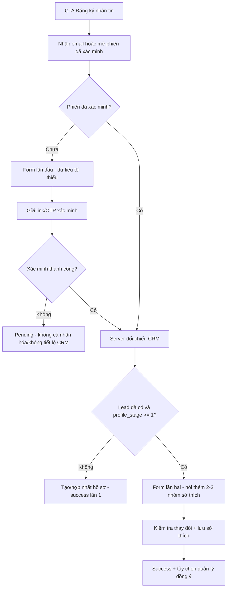

# UEL STYLE — LANDING PAGE LAYOUT BLUEPRINT

> **Version:** 2.0 — 28/10/2026 (bổ sung Lead Form, Progressive Profiling & Data Reconciliation)  
> **Reference website:** [Levents®](https://www.levents.asia/)  
> **Deliverable:** Hướng dẫn bố trí UI/UX cho landing page thời trang UEL STYLE, dành cho Figma, Webflow, Framer, React/Next.js hoặc AI coding agent.  
> **Scope:** Layout + visual hierarchy + responsive + component spec + **lead capture CTA, two-visit progressive profiling, xác minh/đối soát dữ liệu, CRM và consent**. Không sao chép nguyên xi đồ họa, hình sản phẩm hoặc tài sản thương hiệu của Levents.

---

## 0. Cách đọc tài liệu và mức độ xác minh

Bản này mô phỏng **logic bố cục của website thời trang Levents**, sau đó điều chỉnh để phù hợp với thương hiệu **UEL STYLE**.

**Các khối đã xác minh trên trang chủ Levents khi kiểm tra ngày 28/10/2026:**

1. Hero chiến dịch và CTA;
2. Khu **New Arrival** với danh sách sản phẩm và nút xem tất cả;
3. Khu **Best Seller** với danh sách sản phẩm và nút xem tất cả;
4. Khối kể chuyện chiến dịch thời trang (**Slow Times Campaign** tại thời điểm kiểm tra);
5. Khu **Styling / Outfit**;
6. Các khối sản phẩm/bộ sưu tập bổ sung;
7. **Our Collection**, **Feedback** và footer chứa liên hệ/hỗ trợ.

**Điều cần phân biệt:** thứ tự khối nói trên được tham khảo từ trang đang hiển thị; **tất cả thông số px, grid, khoảng cách, hiệu ứng, CTA, nội dung và cấu trúc mở rộng bên dưới là đề xuất thiết kế cho UEL STYLE**, không phải số đo hoặc đặc tả kỹ thuật gốc của Levents.

Nguồn: https://www.levents.asia/ (trang có thể thay đổi sau ngày kiểm tra).

---

## 1. Mục tiêu landing page

### 1.1. UX goal

- Khi mở trang, người dùng nhận ra ngay **UEL STYLE** là một brand thời trang/campus merchandise.
- Trong 3–5 giây đầu, thấy rõ hero campaign + một hành động chính: **Khám phá sản phẩm**.
- Trong một lần cuộn, đi từ **cảm hứng thời trang** → **sản phẩm mới** → **sản phẩm nổi bật** → **lookbook** → **hành động mua hàng**.
- Người dùng mobile có thể mở một sản phẩm hoặc nhắn fanpage trong không quá vài thao tác.

### 1.2. Mô hình chuyển đổi — commerce + lead capture

**Hai nhánh chuyển đổi cùng tồn tại:**

- **Nhánh khám phá/mua sắm:** `Khám phá sản phẩm` → `#new-arrivals`, `Xem sản phẩm` → URL sản phẩm UEL Store, `Nhắn UEL STYLE` → Facebook.
- **Nhánh đăng ký nhận tin (mới):** `Đăng ký nhận tin` hoặc `Nhận ưu đãi & bộ sưu tập mới` → `/dang-ky?source=<placement>` (route hoặc anchor `#dang-ky`, ưu tiên route riêng trên mobile) → form → xác minh liên hệ → CRM → consent-aware marketing.

**CTA dẫn tới form phải có thật** (không phải nút trang trí). CTA đặt ở header, khối giữa trang và section lead capture trước footer; không chiếm CTA mua sắm trong từng product card. Nội dung ưu đãi chỉ dùng nếu có chương trình đã được xác nhận; nếu không, dùng `Nhận tin về bộ sưu tập & hoạt động UEL STYLE`.

**Phân biệt hai lần điền:** “Lần đầu” = chưa có hồ sơ được **xác minh**; “lần hai” = người dùng đã xác minh quyền sở hữu email/số liên hệ và quay lại một phiên sau để bổ sung hồ sơ. **Không** đồng nhất với Step 1/Step 2 của một wizard trong cùng một phiên. Xem phần 12–20.

---

## 2. Brand hierarchy — KHÔNG nhầm UEL và UEL STYLE

| Thành phần | **UEL STYLE** | **UEL / Trường Đại học Kinh tế – Luật** |
|---|---|---|
| Vai trò | **Thương hiệu chính của landing page** | Nhận diện nhà trường, có thể liên quan đến nguồn gốc/cộng đồng |
| Dấu hiệu logo | Wordmark `UEL` nghiêng, viền xanh, ruột kem; đường ngang vàng, ngôi sao vàng; chữ `STYLE` giãn tracking | Biểu trưng chính thức theo bộ nhận diện trường UEL, **không phải** wordmark UEL STYLE |
| Header | **Dùng logo UEL STYLE** | Không sử dụng để thay thế logo UEL STYLE |
| Hero | Nêu tên/chiến dịch của UEL STYLE | Có thể nhắc tới cộng đồng UEL dưới dạng câu chữ |
| Footer | Logo UEL STYLE + thông tin UEL STYLE | Chỉ thêm logo UEL chính thức khi có asset chuẩn và được phép dùng |
| Favicon | Icon/biến thể chính thức UEL STYLE sau khi được phê duyệt | Không lấy favicon/logo nhà trường làm favicon của UEL STYLE |

**QUY TẮC BẮT BUỘC:**

- Trang phải thể hiện rõ tên **UEL STYLE**, không trình bày thành website chính thức của trường.
- Không dùng logo `UEL` của trường thay cho ảnh logo UEL STYLE đã được người dùng cung cấp.
- Không cắt chữ `STYLE` ra khỏi logo đầy đủ và không tự tạo biến thể logo khi chưa được duyệt.
- Logo từ ảnh tham chiếu có biểu tượng giao diện nổi trên ảnh chụp; cần sử dụng **file logo sạch** (SVG/PNG trong suốt) trước khi lên production.
- Không sao chép wordmark hoặc màu brand của Levents lên UEL STYLE.

### 2.1. Palette cho landing page UEL STYLE

Màu gần đúng lấy từ **ảnh logo UEL STYLE người dùng đã cung cấp**, **không phải** mã màu chính thức của trường UEL:

| Token | HEX | Ứng dụng |
|---|---|---|
| `--brand-blue` | `#2C529D` | Logo context, nút chính, active link, accent heading |
| `--brand-gold` | `#F0B746` | Ngôi sao, đường kẻ và accent ít sử dụng |
| `--brand-cream` | `#FDFAF3` | Nền editorial/campaign |
| `--white` | `#FFFFFF` | Nền chính, card sản phẩm |
| `--ink` | `#1F2A3D` | Chữ chính |
| `--muted` | `#657185` | Mô tả, metadata |
| `--line` | `#E5E8EF` | Viền mảnh / divider |

**Gợi ý phân bổ:** 70% trắng + kem, 25% xanh, tối đa 5% vàng. Không dùng chữ vàng nhỏ trên nền trắng vì thiếu tương phản.

---

## 3. Tổng quan bố cục (page architecture)

### 3.1. Thứ tự section khuyến nghị

| STT | Section | Mục đích | Thứ tự ưu tiên |
|---:|---|---|---|
| 01 | Announcement strip (tùy chọn) | Thông báo ưu đãi hoặc sự kiện | Phụ |
| 02 | Sticky header | Logo, menu, tìm kiếm/CTA | Rất cao |
| 03 | **Full-bleed campaign hero** | Truyền tải gu thời trang và nút mua | **Cao nhất** |
| 04 | **New Arrivals** | Sản phẩm mới, thúc đẩy khám phá | Rất cao |
| 05 | **Best Sellers** | Sản phẩm tiêu biểu/dễ chọn | Rất cao |
| 06 | **Campaign / Brand Story** | Tăng chiều sâu và bản sắc UEL STYLE | Cao |
| 07 | **Styling / Lookbook** | Gợi ý mix & match, lifestyle | Cao |
| 08 | Category / Collection cards | Đi nhanh đến nhóm hàng | Trung bình |
| 09 | Social proof / UELers' picks | Hình khách hàng hoặc cảm nhận được phép dùng | Trung bình |
| 10 | Shopping guide + CTA | Giải thích cách mua, giao/nhận hàng | Cao |
| 11 | **Lead magnet / Đăng ký nhận tin** | **Thu thập lead có đồng ý; CTA tới form thích ứng** | **Rất cao** |
| 12 | Footer | Liên hệ, điều hướng, chính sách dữ liệu | Bắt buộc |

> **Lưu ý:** Mục 01, 08, 09, 10, 11 là các **bổ sung phù hợp UEL STYLE**, không khẳng định có cùng cấu trúc trên Levents. Khi cần bản MVP ngắn: ưu tiên 02→03→04→05→06→07→10→11→12.

### 3.2. Wireframe desktop (artboard tham chiếu 1440px)

```text
┌────────────────────────────────────────────────────────────────────────────────┐
│ ANNOUNCEMENT BAR (optional, 28–36px): New drop / Thông báo                       │
├────────────────────────────────────────────────────────────────────────────────┤
│ HEADER (80px)                                                                  │
│ [UEL STYLE logo]   SẢN PHẨM   MỚI NHẤT   BÁN CHẠY   LOOKBOOK    [Tìm kiếm] [CTA]│
├────────────────────────────────────────────────────────────────────────────────┤
│                                                                                │
│                   FULL-BLEED CAMPAIGN PHOTO / VIDEO                           │
│                                                                                │
│        NHÃN CHIẾN DỊCH                                                        │
│        MANG CHẤT UEL.                                                         │
│        MẶC THEO CHẤT RIÊNG.                                                    │
│        [KHÁM PHÁ SẢN PHẨM]                                                     │
│                                                                                │
├────────────────────────────────────────────────────────────────────────────────┤
│ NEW ARRIVALS                                                    [Xem tất cả →] │
│                                                                                │
│ [  Product card 1  ] [  Product card 2  ] [  Product card 3  ] [ Product card 4 ]│
│ [Ảnh 3:4]           [Ảnh 3:4]           [Ảnh 3:4]           [Ảnh 3:4]          │
│ [Tên, giá]          [Tên, giá]          [Tên, giá]          [Tên, giá]          │
├────────────────────────────────────────────────────────────────────────────────┤
│ BEST SELLERS                                                    [Xem tất cả →] │
│ [  Product card 1  ] [  Product card 2  ] [  Product card 3  ] [ Product card 4 ]│
├────────────────────────────────────────────────────────────────────────────────┤
│                                                                                │
│               EDITORIAL CAMPAIGN (ảnh lớn, tràn chiều ngang)                   │
│               [Tên bộ sưu tập] [Thông điệp ngắn] [Khám phá →]                   │
│                                                                                │
├────────────────────────────────────────────────────────────────────────────────┤
│ STYLING / LOOKBOOK                                              [Xem tất cả →] │
│ [  OUTFIT 1  ]         [  OUTFIT 2  ]         [  OUTFIT 3  ]                    │
│ [Ảnh người mặc]       [Ảnh người mặc]       [Ảnh người mặc]                   │
│ [Xem bộ phối →]       [Xem bộ phối →]       [Xem bộ phối →]                     │
├────────────────────────────────────────────────────────────────────────────────┤
│ KHÁM PHÁ DANH MỤC                                                              │
│ [ T-SHIRTS ]          [ HOODIES / POLOS ]      [ ACCESSORIES ]                  │
├────────────────────────────────────────────────────────────────────────────────┤
│ UELERS' PICKS / COMMUNITY        [Ảnh thật/UGC] [Lời chia sẻ được phép đăng]    │
├────────────────────────────────────────────────────────────────────────────────┤
│ HƯỚNG DẪN MUA HÀNG:   01 Chọn mẫu → 02 Xem/nhắn → 03 Nhận hàng   [SHOP NOW]     │
├────────────────────────────────────────────────────────────────────────────────┤
│ FOOTER: [UEL STYLE]  Khám phá | Hỗ trợ | Liên hệ | Facebook | UEL Store         │
└────────────────────────────────────────────────────────────────────────────────┘
```

### 3.3. Wireframe mobile (artboard tham chiếu 390px)

```text
┌──────────────────────────┐
│ Announcement (optional)  │
├──────────────────────────┤
│ [☰] [UEL STYLE LOGO] [⌕] │
├──────────────────────────┤
│                          │
│     CAMPAIGN IMAGE       │
│      (portrait)          │
│                          │
│   MANG CHẤT UEL.         │
│   MẶC THEO CHẤT RIÊNG.   │
│   [KHÁM PHÁ SẢN PHẨM]    │
├──────────────────────────┤
│ NEW ARRIVALS   [Tất cả →]│
│ [Card 1]      [Card 2]   │
│ [Card 3]      [Card 4]   │
├──────────────────────────┤
│ BEST SELLERS   [Tất cả →]│
│ [Card 1]      [Card 2]   │
├──────────────────────────┤
│ CAMPAIGN IMAGE 4:5       │
│ [Tên chiến dịch]         │
│ [Khám phá →]             │
├──────────────────────────┤
│ STYLING / LOOKBOOK       │
│ [Outfit card slider →]   │
├──────────────────────────┤
│ COLLECTION / CATEGORY    │
│ [Card nhóm hàng]         │
├──────────────────────────┤
│ UELERS' PICKS            │
│ [Ảnh + chia sẻ]          │
├──────────────────────────┤
│ MUA HÀNG THẾ NÀO?        │
│ [3 bước xếp dọc]         │
│ [NHẮN UEL STYLE]         │
├──────────────────────────┤
│ FOOTER (accordion)       │
└──────────────────────────┘
```

---

## 4. Layout system / Design tokens

### 4.1. Grid & container

| Breakpoint | Khung nội dung | Lề ngang | Grid sản phẩm | Khoảng cách |
|---|---:|---:|---|---:|
| Desktop ≥1280px | max-width `1280px` | `40px` | 4 columns | `20–24px` |
| Laptop 1024–1279px | fluid | `32px` | 4 columns | `16–20px` |
| Tablet 768–1023px | fluid | `24px` | 2–3 columns | `16px` |
| Mobile <768px | fluid | `16px` | 2 columns | `10–12px` |

- `hero` và `campaign` là **full-bleed**: hình nền chiếm toàn bộ viewport width, **không** bị giới hạn bởi `.container`.
- Các vùng listing dùng **centered max-width container** để hàng sản phẩm thẳng cột.
- Khoảng cách section desktop `88–112px`, tablet `72px`, mobile `48–64px`.
- Hình sản phẩm ưu tiên tỷ lệ **3:4**; hình lookbook **3:4 hoặc 4:5**; banner desktop **16:7–16:9**; mobile **4:5 hoặc 3:4**.
- Sử dụng `object-fit: cover`; tránh cắt mặt người, chi tiết áo và logo trên trang phục.

### 4.2. Scale về typography

| Thành phần | Desktop | Mobile | Ghi chú |
|---|---|---|---|
| Hero headline | 56–72px / 700–800 | 34–42px / 700–800 | Giữ 2–3 dòng |
| Section title | 30–40px / 700 | 24–28px / 700 | Uppercase tùy concept |
| Product title | 14–16px / 500–600 | 13–14px / 500–600 | Clamp 2 dòng |
| Product price | 15–16px / 700 | 14–15px / 700 | Không dùng màu vàng nhạt |
| Body | 16px / 400 | 15–16px / 400 | Line height ≥1.5 |
| Button | 15–16px / 600–700 | 14–16px / 600–700 | Chiều cao ≥44px |

**Font đề xuất:** Montserrat (display) + Be Vietnam Pro (nội dung). **Logo là artwork riêng**, không tái tạo bằng font.

### 4.3. Button & surfaces

```css
:root {
  --brand-blue: #2C529D;
  --brand-gold: #F0B746;
  --brand-cream: #FDFAF3;
  --white: #FFFFFF;
  --ink: #1F2A3D;
  --muted: #657185;
  --line: #E5E8EF;
  --container: 1280px;
  --gutter-desktop: 40px;
  --gutter-mobile: 16px;
  --section-gap-desktop: 96px;
  --section-gap-mobile: 56px;
  --radius-button: 6px;
  --radius-product: 4px;
}

.layout-container {
  width: min(calc(100% - 2 * var(--gutter-desktop)), var(--container));
  margin-inline: auto;
}
@media (max-width: 767px) {
  .layout-container { width: calc(100% - 2 * var(--gutter-mobile)); }
}
```

**Visual principle:** giống tinh thần storefront thời trang ở chỗ sử dụng **ảnh lớn, nền thoáng, typography tiết chế, hình sản phẩm đồng nhất**; tránh biến mỗi sản phẩm thành một card đổ bóng nặng như dashboard.

---

## 5. Section-by-section — layout triển khai chi tiết

### 5.1. Section A — Announcement strip (optional)

- **Vị trí:** trên header, cao `28–36px`.
- **Bố cục:** một dòng text centered; nếu có ưu đãi thì kèm link ngắn.
- **Mẫu:** `Campus essentials — Khám phá những thiết kế mang dấu ấn UEL`.
- **Hành vi:** ẩn hẳn nếu không có thông báo thực; không tạo banner sale giả.

### 5.2. Section B — Header

**Desktop:**

- Chiều cao `76–84px`, nền trắng; `border-bottom: 1px solid #E5E8EF`.
- 3 zone theo tỷ lệ gợi ý **22% / 56% / 22%**:
  - **Trái:** logo UEL STYLE. Hiển thị logo sạch ở bề rộng `130–170px`, tùy tỷ lệ thực tế.
  - **Giữa:** `Sản phẩm` · `Mới nhất` · `Bán chạy` · `Lookbook` · `Về UEL STYLE`.
  - **Phải:** icon tìm kiếm nếu có tìm kiếm thật; CTA `Nhắn UEL STYLE` hoặc link `UEL Store`.
- `position: sticky; top: 0; z-index: 50` sau khi rời hero; nền mờ nhẹ chỉ khi đã cuộn.
- Không cần `Cart` và `Account` nếu landing page chưa có ecommerce backend.

**Mobile:**

- Chiều cao `60–68px`.
- Hamburger trái; **logo UEL STYLE** chính giữa với chiều ngang `100–128px`; icon bên phải.
- Menu thành drawer phủ `85–90vw`; có backdrop và nút đóng; focus management/scroll lock.
- Nút chat Facebook có thể đặt trong drawer + cuối hero thay vì thêm 2–3 icon cố định gây rối.

### 5.3. Section C — Hero campaign full-bleed (điểm nhấn số 1)

**Desktop layout:**

- Full width, `min-height: 620px`, gợi ý `height: 74–85svh`, tối đa khoảng `820px`.
- Nền là **ảnh editorial UEL STYLE** chụp sinh viên/model thật mặc sản phẩm; crop ưu tiên để người mẫu chiếm ~55–65% bên phải, **negative space bên trái** dành cho copy.
- Gradient overlay dịu ở vùng text nếu ảnh sáng/tối không đồng đều (giữ tính chân thật).
- Content align left bên trong container, max-width `540px`; giữa theo chiều dọc.
- Thứ tự: label nhỏ `UEL STYLE / CAMPUS COLLECTION` → H1 2–3 dòng → mô tả ngắn → nút primary.
- CTA chính dẫn `#new-arrivals`; CTA phụ (nếu dùng) dẫn `#lookbook`.

**Mobile layout:**

- Dùng ảnh crop **4:5**, hoặc tách block ảnh và block chữ để copy không đè lên mặt/mẫu áo.
- `min-height: 560–640px` nếu overlay; headline `34–42px`.
- CTA tối thiểu 44px cao; content cách mép `20px`, cách đáy tối thiểu `32px`.
- Không dùng carousel tự chạy nhiều slide ở bản MVP; một hero mạnh tốt hơn nhiều hero yếu.

**Copy mẫu:**

```text
UEL STYLE / CAMPUS DROP
MANG CHẤT UEL.
MẶC THEO CHẤT RIÊNG.
Trang phục và phụ kiện cho những ngày mang đậm tinh thần UEL.
[KHÁM PHÁ SẢN PHẨM]
```

> Copy trên là **đề xuất**, không tự nhận là khẩu hiệu chính thức.

### 5.4. Section D — New Arrivals (nhóm sản phẩm đầu tiên)

- **Đặt ngay sau hero**, không chen nhiều đoạn giới thiệu để giữ nhịp mua sắm.
- Container tối đa `1280px`; padding block desktop `96px`, mobile `56px`.
- Hàng tiêu đề: trái `NEW ARRIVALS`, phải `Xem tất cả →`, cùng baseline.
- **Desktop:** 4 sản phẩm/hàng; cho phép 2 hàng hoặc slider ngang (khuyên dùng 1 hàng 4 sản phẩm ở MVP).
- **Mobile:** 2 sản phẩm/hàng; 4–6 sản phẩm; giữ card đồng nhất chiều cao.
- **Product card:** ảnh 3:4 → tag mới (nếu thực) → tên sản phẩm 2 dòng → giá → CTA xem chi tiết. Không hiển thị giá/size/tồn kho chưa kiểm chứng.
- Hover desktop: đổi sang ảnh thứ hai (nếu có) + reveal link `Xem sản phẩm`; touch mobile luôn có đường mở sản phẩm rõ ràng.
- **Nguồn:** sản phẩm mới thực tế từ UEL Store; ảnh 1:1 cần crop thành 3:4 bằng shot chuẩn thay vì kéo giãn.

**Product card wireframe:**

```text
┌──────────────────────────────┐
│ [NEW]                        │
│                              │
│          PRODUCT             │
│          IMAGE 3:4           │
│                              │
│      [Xem sản phẩm]          │
├──────────────────────────────┤
│ Tên áo / phụ kiện            │
│ 230.000đ                     │
└──────────────────────────────┘
```

### 5.5. Section E — Best Sellers (nhóm sản phẩm thứ hai)

- Bố cục **giống New Arrivals** nhằm tạo tính hệ thống và tốc độ đọc.
- Tựa `BEST SELLERS` / `ĐƯỢC UELERS YÊU THÍCH`.
- 4 sản phẩm desktop, 2 cột mobile; CTA `Xem tất cả`.
- Chỉ dùng badge `Bán chạy` khi có dữ liệu bán hàng/đơn vị kinh doanh xác nhận. Nếu chưa có dữ liệu, đổi tiêu đề thành **Sản phẩm nổi bật**.
- Có thể thay một sản phẩm bằng hoodie/polo/phụ kiện để tránh 4 card gần giống nhau.

### 5.6. Section F — Campaign / Brand story (editorial break)

- Vai trò: **ngắt nhịp** giữa các cụm listing dày, giới thiệu tinh thần UEL STYLE.
- Full width hoặc 2 cột **60% ảnh / 40% nội dung**; desktop chiều cao `560–700px`.
- Nền #FDFAF3 hoặc ảnh lifestyle trải ngang, rất ít decoration.
- Layout ưu tiên:
  - Desktop: ảnh trái (người mẫu trong campus), nội dung phải (eyebrow → H2 → 2–3 câu → text-link).
  - Mobile: ảnh full width 4:5 → nội dung căn trái bên dưới, không nhồi text dài lên ảnh.
- Concept mẫu: `MADE FOR CAMPUS DAYS` / `Từ giảng đường đến mọi khoảnh khắc của bạn`.
- CTA `Khám phá tinh thần UEL STYLE` dẫn `#lookbook` hoặc `#about`.
- **Không sử dụng hình ảnh chiến dịch, tên bộ sưu tập hay nhân vật độc quyền của Levents**.

### 5.7. Section G — Styling / Lookbook

- **Là điểm khác biệt chính** biến website từ một bảng sản phẩm thành trang fashion lifestyle.
- Heading `UELERS IN STYLE` hoặc `STYLING IDEAS`; nhãn `LOOKBOOK`.
- **Desktop:** 3 ảnh outfit 3:4 mỗi hàng (hoặc slider có 3 item visible), gap `20–24px`.
- **Mobile:** carousel ngang với item rộng `78–86vw` để lộ mép item tiếp theo; có thao tác vuốt thật và nút xem outfit.
- Mỗi outfit card: ảnh người mặc toàn thân, tên outfit/tên mẫu, caption 1 dòng, CTA `Xem bộ phối`.
- Có thể thêm **shop the look** (liên kết riêng từng sản phẩm) nếu xác định được sản phẩm trong ảnh.
- Nội dung ảnh ưu tiên sinh viên/campus thật có đồng ý sử dụng hình ảnh.

### 5.8. Section H — Shop by Category / Collection (bổ sung cho UEL STYLE)

- Không cần đưa lên quá cao vì hero → new arrivals → best sellers đang là nhịp tham khảo chính.
- Desktop: **3 card ngang** 1:1 hoặc 4:5, đồng nhất chiều cao:
  1. `T-SHIRTS & POLOS`
  2. `HOODIES & CAMPUS WEAR`
  3. `BAGS & ACCESSORIES`
- Mobile: xếp 1 cột ảnh ngang 3:2 hoặc 2 cột + card thứ ba full width.
- Text category và mũi tên ở mép dưới, có overlay gradient để đảm bảo độ đọc.
- Nút dẫn trang danh mục thực tế. Không tạo link đến danh mục không tồn tại.

### 5.9. Section I — UELers' Picks / Community (bổ sung)

- Mục đích: tạo uy tín xã hội từ cộng đồng thay vì dùng review không có nguồn.
- Desktop: 3–4 ảnh/feedback cards; mobile slider 1–1.2 item.
- Nội dung chỉ sử dụng khi có quyền và consent: ảnh sinh viên mặc đồ UEL STYLE, story ngắn, attribution được phép chia sẻ.
- Nếu chưa có data, dùng **gallery ảnh sản phẩm editorial**, **không tạo testimonial, đánh giá sao hoặc con số đơn hàng giả**.

### 5.10. Section J — How to Shop + final CTA

- Nền `#FDFAF3`, nội dung trong `.layout-container`.
- Headline `MANG UEL STYLE VỀ TỦ ĐỒ CỦA BẠN`.
- Ba bước: `01 Chọn sản phẩm` → `02 Xem tại UEL Store / Nhắn fanpage` → `03 Xác nhận phương thức nhận hàng`.
- CTA chính `XEM SẢN PHẨM TẠI UEL STORE`; CTA phụ `NHẮN UEL STYLE`.
- Chính sách mua hàng, giao nhận, đổi trả chỉ ghi theo thông tin đang được công bố chính thức, không tự cam kết miễn phí ship hay đổi trả.

### 5.11. Section K — Footer

- Desktop 4 cột, trên nền trắng hoặc xanh `#2C529D` (nếu dùng nền xanh phải bảo đảm logo variant đúng và độ tương phản).
- Col 1: **logo UEL STYLE**, mô tả ngắn.
- Col 2: `Khám phá` → New Arrivals, Best Sellers, Lookbook.
- Col 3: `Hỗ trợ` → Mua hàng, chính sách/link chính thức, liên hệ.
- Col 4: `Kết nối` → Facebook UEL STYLE, UEL Store.
- Bottom row: copyright và các liên kết pháp lý thích hợp.
- **Không mặc định đặt logo trường UEL trong footer**. Chỉ thêm khi được phê duyệt, dùng đúng logo gốc và mô tả quan hệ chính xác.
- Mobile: các nhóm liên kết có thể dạng accordion, nhưng contact CTA phải hiện rõ.

---

## 6. Responsive behavior — nguyên tắc không được bỏ qua

| Thành phần | Desktop | Mobile |
|---|---|---|
| Header | 3 zones + menu ngang | Hamburger + logo chính giữa |
| Hero | Full-bleed 16:7–16:9 | 4:5 hoặc split image/text |
| Heading section | Trái / link phải | Trái / link phải, font nhỏ hơn |
| Product grid | 4 cards / row | 2 cards / row |
| Campaign | 60/40 hoặc full-width | Stack image → text |
| Lookbook | 3 cards / row | Horizontal swipe slider |
| Category | 3 cards / row | 1–2 cards / row |
| Footer | 4 columns | 1 column / accordion |
| CTA chính | Scroll anchor / product link | Cùng đích, tap area ≥44px |

**Breakpoints đề xuất:** `sm <768px`, `md 768–1023px`, `lg ≥1024px`, `xl ≥1280px`. Kiểm tra thực tế tại 360, 390, 768, 1024, 1280, 1440px.

- Không tạo horizontal overflow trang ở 360px.
- Ảnh phải có `srcset`/`sizes`; hero mobile dùng ảnh riêng nếu crop desktop làm mất chủ thể.
- Có `prefers-reduced-motion`; không bắt buộc chuyển động parallax.
- Sticky header không được che anchor sections: `scroll-margin-top: 88px` (tùy chiều cao header).

---

## 7. Cấu trúc components (dành cho dev hoặc AI coding agent)

```text
app/
└─ page.tsx
components/
├─ AnnouncementBar
├─ Header
│  ├─ BrandLogo      # UEL STYLE ONLY
│  ├─ DesktopNav
│  └─ MobileNavDrawer
├─ CampaignHero
├─ SectionHeading
├─ ProductGrid
│  └─ ProductCard
├─ EditorialCampaign
├─ LookbookCarousel
│  └─ OutfitCard
├─ CategoryGrid
├─ CommunityGallery
├─ ShoppingGuide
├─ LeadCaptureSection
│  ├─ SubscribeCTA
│  └─ LeadFormEntry
└─ Footer

/ dang-ky
├─ LeadSignupPage
├─ ContactVerification
├─ ReturningProfileForm
└─ ConsentPreferenceCenter
```

**Dữ liệu đề xuất cho một sản phẩm:**

```ts
type Product = {
  id: string;
  name: string;
  imageUrl: string;
  imageAlt: string;
  priceVnd?: number;        // Chỉ hiển thị khi được cập nhật/xác nhận
  href: string;             // Link chi tiết thực tế trên UEL Store
  tag?: 'new' | 'featured'; // Không gắn 'best seller' nếu chưa có bằng chứng
  secondImageUrl?: string;
};
```

**Minimum interactions:**

- Header menu links scroll hoặc mở trang đúng đích.
- Hero CTA scroll `#new-arrivals`.
- Product card: toàn card hoặc link `Xem sản phẩm` có thể click/tap.
- `Xem tất cả` mở danh mục liên quan.
- Lookbook carousel hỗ trợ keyboard, pointer, swipe và trạng thái focus.
- Facebook CTA mở đúng fanpage UEL STYLE.
- `Đăng ký nhận tin` dẫn đến `/dang-ky` và tracking vị trí CTA; không tự động gửi email marketing khi chưa opt-in.
- Khi quay lại, trạng thái form lấy từ server sau verify, không chỉ dựa vào cookie hoặc form submit count.
- Không hiển thị nút không hoạt động (`Search`, `Cart`, `Subscribe`) chỉ để trang trông giống Levents.

---

## 8. Asset checklist cho designer / content team

| Asset | Số lượng đề xuất | Quy cách |
|---|---:|---|
| Logo **UEL STYLE** sạch | 1–2 biến thể được duyệt | SVG + PNG nền trong suốt; không dùng ảnh chụp có UI overlay |
| Hero desktop | 1 | ≥1920×1080, chừa negative space cho chữ |
| Hero mobile | 1 | ≥1080×1350, chủ thể không bị crop |
| Product photos | 8–12 | Ảnh đồng bộ, tốt nhất 3:4, nền/ánh sáng thống nhất |
| Campaign editorial | 1–2 | Ảnh ngang và ảnh dọc |
| Outfit / Styling | 3–6 | 3:4 hoặc 4:5, người mặc sản phẩm thật |
| Category covers | 3 | 4:5 hoặc 1:1 |
| UGC/community | 0–4 | Chỉ dùng khi có quyền sử dụng |
| Dữ liệu sản phẩm | theo ảnh | Tên, giá, URL thực tế, tình trạng hàng |

**Định hướng art direction:** ảnh thật, ánh sáng tự nhiên hoặc studio sạch, sản phẩm là trọng tâm, không lạm dụng sticker/gradient. Được lấy *cảm hứng layout* từ Levents; **không tải và tái sử dụng ảnh campaign của Levents như asset UEL STYLE**.

---

## 9. Checklist nghiệm thu layout

### Brand integrity

- [ ] Header, hero và footer đều dùng **UEL STYLE** như thương hiệu chính.
- [ ] Không dùng logo trường UEL thay cho logo UEL STYLE.
- [ ] Logo UEL STYLE đầy đủ còn chữ `STYLE`, đường vàng và ngôi sao; không kéo méo.
- [ ] Màu xanh/vàng/kem lấy từ logo UEL STYLE, không đồng nhất với bộ màu quy chuẩn của nhà trường.

### Visual / responsive

- [ ] Hero full-bleed, không có lề trắng ngoài ý muốn.
- [ ] Bốn sản phẩm/hàng desktop; hai sản phẩm/hàng mobile.
- [ ] Ảnh tất cả product cards cùng tỷ lệ và không méo.
- [ ] Mọi section sử dụng hệ spacing nhất quán.
- [ ] Ảnh và text campaign không chồng lấn ở màn nhỏ.
- [ ] Không overflow ngang ở 360px; menu mobile mở/đóng đúng.

### Functional / content

- [ ] CTA đều hoạt động; không có nút giả.
- [ ] Giá, sản phẩm, hình ảnh và link được kiểm tra theo UEL Store trước khi publish.
- [ ] Không tự nhận bestseller, hết hàng, ưu đãi, testimonial nếu chưa xác minh.
- [ ] CTA liên hệ trỏ về https://www.facebook.com/uelstyle.
- [ ] CTA `Đăng ký nhận tin` dẫn đến form hoạt động trên desktop/mobile; click có tracking placement.
- [ ] Lần đầu thấy form ngắn; lần sau **chỉ khi xác minh danh tính hợp lệ** mới thấy form bổ sung thông tin.
- [ ] Submit tạo/ghi vào CRM theo khóa định danh chuẩn hóa, có xử lý bản ghi trùng, idempotency và log đối soát.
- [ ] Email sai định dạng, email chưa xác minh, xung đột danh tính hoặc trùng bản ghi không được âm thầm ghi đè.
- [ ] Đồng ý marketing là checkbox tự nguyện, không tick sẵn; lưu version nội dung đồng ý và thời điểm.
- [ ] Có trang chính sách dữ liệu, cách hủy nhận tin; không thu thập dữ liệu nhạy cảm không liên quan.
- [ ] Không hiện tên, số điện thoại, lịch sử mua hoặc câu trả lời cũ cho người chỉ biết email mà chưa OTP.

- [ ] Ảnh có `alt`; trang có thứ tự heading H1→H2 hợp lý.
- [ ] Ưu tiên tải ảnh hero, lazy-load ảnh dưới fold; tôn trọng reduced motion.

---

## 10. Prompt copy/paste cho AI website builder

> Thiết kế và lập trình **landing page thời trang UEL STYLE**, tham khảo **logic bố cục** từ trang chủ Levents (https://www.levents.asia/): campaign hero full-bleed → New Arrivals → Best Sellers/Featured Products → editorial campaign → styling/lookbook → collections/categories → community → shopping guide → footer. Sử dụng layout fashion storefront tối giản, giàu ảnh, typography sắc nét và khoảng trắng rộng. Desktop dùng product grid 4 cột; mobile 2 cột; mobile lookbook có carousel vuốt ngang. Hero desktop có headline/CTA trên khoảng trống của ảnh; mobile dùng crop phù hợp để không che mẫu. Màu **UEL STYLE**: xanh `#2C529D`, vàng accent `#F0B746`, kem `#FDFAF3`; màu này lấy từ ảnh tham chiếu và cần đối chiếu file logo gốc khi production. **Đặc biệt: logo UEL STYLE là logo chữ UEL nghiêng có chữ STYLE và sao vàng; KHÔNG phải logo chính thức của trường UEL.** Logo UEL STYLE là logo chính ở header/footer. Không dùng logo trường UEL thay thế hoặc làm favicon. Nội dung sản phẩm chỉ lấy từ nguồn UEL Store; CTA điều hướng đến UEL Store và Facebook UEL STYLE. Không dựng nút cart/search nếu chưa có chức năng thật. **Bổ sung CTA Đăng ký nhận tin ở header/giữa trang/trước footer → route /dang-ky với UEL STYLE branding. Progressive profiling theo lần truy cập đã xác minh: lần đầu form ngắn + opt-in, lần sau hỏi thêm sở thích sau khi xác minh email/OTP. Tích hợp CRM, dedup email/phone, chuẩn hóa dữ liệu, idempotency, xử lý xung đột, audit log, unsubscribe và privacy policy; không tiết lộ dữ liệu khách chỉ từ việc nhập email.** Tạo components tái sử dụng, responsive tại 360/390/768/1024/1440px, SEO và accessibility tốt. Không sao chép ảnh/creative hoặc brand asset của Levents.


---

## 12. Mở rộng landing page — CTA đăng ký nhận thông tin

### 12.1. Vai trò trong conversion funnel

```text
LANDING PAGE
   ├── Khám phá sản phẩm → UEL Store/Facebook (commerce)
   └── [Đăng ký nhận tin] → /dang-ky?source=header|campaign|footer
                               ↓
                     Nhập email & dữ liệu tối thiểu
                               ↓
                          Xác minh OTP / link
                               ↓
                     Đối soát CRM / hợp nhất lead
                               ↓
              ┌──────────────┴─────────────────┐
          Lead mới đã xác minh           Lead cũ đã xác minh
          → Success lần 1               → Form bổ sung lần 2
              └──────────────┬─────────────────┘
                       Consent & preferences
                               ↓
                    Chỉ gửi tin nếu được phép
```

**Quan trọng:** dữ liệu từ form được phép lưu để thực hiện yêu cầu đăng ký và quản lý liên hệ theo chính sách đã công bố. **Chỉ gửi marketing khi có cơ sở đồng ý/được phép tương ứng**. Không biến xác minh email thành mặc định đồng ý quảng cáo.

### 12.2. Placement / thứ bậc CTA

| Vị trí | Nội dung CTA | Đích | Ưu tiên |
|---|---|---|---|
| Header desktop | `Nhận tin mới` | `/dang-ky?source=header` | Secondary outline |
| Header mobile | Trong menu + nút gọn | `/dang-ky?source=mobile_nav` | Secondary |
| Hero campaign | `Khám phá bộ sưu tập` + `Đăng ký nhận tin` | Product grid + form | Commerce chính, lead phụ |
| Sau Lookbook | `Bắt nhịp cùng UEL STYLE` | `/dang-ky?source=lookbook` | Contextual |
| Lead section trước footer | `Nhận tin từ UEL STYLE` | Form nhúng hoặc route | CTA chính của section |
| Footer | `Đăng ký cập nhật` | `/dang-ky?source=footer` | Secondary |

**Không** ép hiển thị popup toàn màn hình ngay khi vừa vào trang; không bắt buộc điền form để xem sản phẩm. **Trong luồng chỉ dùng để đăng ký nhận tin, nên làm rõ rằng cần xác nhận đồng ý nhận email để hoàn tất đăng ký newsletter**; khách không đồng ý vẫn được phép rời form, xem sản phẩm và sử dụng chức năng không liên quan. Trên mobile, dùng route riêng tránh modal khó đọc/khó điều hướng.

### 12.3. Wireframe landing CTA (desktop)

```text
┌───────────────────────────────────────────────────────────────────────┐
│                     JOIN THE UEL STYLE COMMUNITY                     │
│                                                                       │
│  [Editorial photo / product]       Nhận tin mới, chất UEL STYLE.      │
│                                   Sản phẩm mới • Lookbook • Sự kiện  │
│                                                                       │
│                                   [ ĐĂNG KÝ NHẬN TIN → ]             │
│                                   Có thể hủy đăng ký bất cứ lúc nào │
└───────────────────────────────────────────────────────────────────────┘
```

- Container: `max-width: 1200px`, 2 cột ảnh 48% / nội dung 52%, radius `16–24px` nếu bố cục editorial card.
- Desktop `padding: 56–72px`, mobile `padding: 24px`; phần hình chuyển lên trên hoặc ẩn nếu làm form quá dài.
- Nền kem `#FDFAF3`, chữ xanh `#2C529D`, CTA xanh chữ trắng; đường vàng `#F0B746` chỉ accent.

---

## 13. Form UI/UX — áp dụng đúng guideline UEL STYLE

### 13.1. Brand architecture (bắt buộc)

| Thành phần | Quy định |
|---|---|
| Logo ở đầu form | **Logo UEL STYLE đầy đủ** (asset sạch đã duyệt) |
| Màu nền | Trắng `#FFFFFF` hoặc kem `#FDFAF3` |
| CTA submit | Xanh UEL STYLE `#2C529D`, chữ trắng |
| Focus ring | Xanh UEL STYLE có đủ tương phản, không chỉ đổi màu border |
| Success icon/accent | Vàng `#F0B746` + xanh, không dùng màu vàng cho chữ nhỏ |
| Logo UEL của trường | **Không thay thế** logo UEL STYLE; chỉ có thể xuất hiện trong phần thông tin liên kết nếu được duyệt |
| UI copy | Trẻ trung, rõ ràng, không quá sale hoặc tạo cảm giác bị ép cung cấp dữ liệu |

Tài liệu này dùng palette **ước lượng từ ảnh logo UEL STYLE**, **không phải** thông số thương hiệu UEL của trường. Cần thay token khi có master brand asset chính thức của UEL STYLE.

### 13.2. Wireframe form lần đầu — NEW VERIFIED CONTACT

```text
┌───────────────────────────── FORM CARD (520px) ───────────────────────────┐
│                        [LOGO UEL STYLE]                                 │
│                                                                         │
│             Vào hội UEL STYLE, cập nhật phong cách mới!                 │
│      Nhận tin sản phẩm, lookbook và hoạt động từ UEL STYLE.             │
│                                                                         │
│      Họ tên / Tên gọi *                                                │
│      [ Nhập tên bạn                                                  ]  │
│      Email *                                                            │
│      [ you@example.com                                               ]  │
│      Bạn là ai trong cộng đồng UEL? (tùy chọn)                           │
│      [ Sinh viên | Cựu sinh viên | Khác | Không muốn trả lời          v]  │
│                                                                         │
│      ☐ Tôi đồng ý nhận email giới thiệu sản phẩm và hoạt động           │
│        từ UEL STYLE. (tự nguyện, không tích sẵn)                         │
│      Chính sách xử lý dữ liệu cá nhân [Xem chi tiết]                     │
│                                                                         │
│                        [ TIẾP TỤC XÁC MINH EMAIL ]                      │
│                 Không cần cung cấp số điện thoại để nhận email          │
└─────────────────────────────────────────────────────────────────────────┘
```

**Ưu tiên tối thiểu hóa dữ liệu:** tên gọi + email là đủ với kênh email. Trường “liên hệ khác” hoặc “mối quan hệ UEL” là tùy chọn. Nếu chỉ phục vụ đăng ký email, có thể chỉ yêu cầu email; không thu thập số điện thoại/ngày sinh/địa chỉ nếu chưa có use case rõ ràng.

**Sau submit lần đầu:**

1. Client kiểm tra schema, normalize dữ liệu, gọi `/api/leads/submit`.
2. Server ghi **pending verification** hoặc đối chiếu lead đã tồn tại theo quy tắc mục 16.
3. Gửi email chứa link xác minh có thời hạn (hoặc OTP).
4. Sau click/OTP hợp lệ: bật trạng thái `verified`. Chỉ hiển thị thông báo **đăng ký nhận tin thành công** nếu người dùng có opt-in hợp lệ; nếu không, hiển thị **xác minh liên hệ thành công, chưa đăng ký bản tin** và cho tùy chọn thay đổi.
5. Không tự động đẩy lead chưa xác minh vào tệp gửi chiến dịch.

### 13.3. Wireframe form lần hai — VERIFIED RETURNING CONTACT

```text
┌───────────────────────────── FORM CARD (520px) ───────────────────────────┐
│                        [LOGO UEL STYLE]                                 │
│                                                                         │
│              Rất vui vì bạn quay lại, [tên đã xác minh]!               │
│          Chọn vài chủ đề phù hợp để UEL STYLE gửi tin đúng gu.          │
│                                                                         │
│     Bạn muốn cập nhật điều gì? (multi-select, tùy chọn)                  │
│     ☐ Áo thun / Polo    ☐ Hoodie / Outerwear    ☐ Phụ kiện             │
│     ☐ Lookbook         ☐ Sự kiện UEL           ☐ Ưu đãi                │
│                                                                         │
│     Phong cách bạn quan tâm? (tùy chọn)                                  │
│     [ Minimal | Streetwear | Campus casual | Khác | Bỏ qua             ] │
│                                                                         │
│     Khoảng giá bạn thường quan tâm? (tùy chọn)                            │
│     [ < 200k | 200–350k | > 350k | Không muốn trả lời                  ] │
│                                                                         │
│             [ LƯU SỞ THÍCH ]         [ ĐỂ SAU ]                         │
│     [Quản lý email & đồng ý nhận tin]                                    │
└─────────────────────────────────────────────────────────────────────────┘
```

- Chỉ hiện thông tin cá nhân/giá trị cũ **sau khi phiên hiện tại có xác minh hợp lệ**, không phải chỉ vì email tồn tại trong CRM.
- Lần hai hỏi tối đa 2–3 nhóm mới; tự động ẩn hoặc điền trước các trường đã biết khi có quyền truy cập.
- Chỉ lưu các câu trả lời đã được người dùng chủ động thay đổi/đồng ý; không ghi đè dữ liệu tốt bằng giá trị rỗng.
- Trường kích thước áo, mối quan tâm mua sắm cụ thể có thể để lần ba, không hỏi vội.
- Nút `Để sau` không làm mất đăng ký nhận tin đã có; `Lưu sở thích` khác với `Bật nhận quảng cáo`.

### 13.4. Mật độ, kích thước và responsive

| Element | Desktop | Mobile |
|---|---|---|
| Form page container | 2 columns: visual/story 45%, form 55% | 1 column, form trước |
| Form max width | `520px` | `100%` trừ 16–20px mỗi bên |
| Form card padding | `32–40px` | `20–24px` |
| Input height | `48–52px` | `52px` |
| Input radius | `10–12px` | `10–12px` |
| Spacing giữa fields | `18–24px` | `16–20px` |
| CTA primary | Full width 48–52px | Full width 52px |
| Title | `28–32px` | `24–28px` |
| Body | `15–16px` | `16px` |
| State/error copy | Bên dưới đúng field | Bên dưới đúng field |

**Accessibility:** label hiện rõ (không chỉ placeholder), đánh dấu trường bắt buộc, error liên kết với input, hỗ trợ bàn phím/screen reader, `autocomplete` đúng chuẩn, `aria-live` ở trạng thái OTP/success, focus first error, tương phản WCAG AA, focus outline rõ, nút tối thiểu 44×44px.

### 13.5. Copy cho các trạng thái

| State | Copy tham khảo |
|---|---|
| Empty | `Cập nhật những điều hay ho từ UEL STYLE.` |
| Invalid email | `Email chưa đúng định dạng, kiểm tra lại giúp tụi mình nhé.` |
| Sending OTP | `Đang gửi email xác minh…` |
| OTP sent | `Kiểm tra hộp thư để xác minh địa chỉ email của bạn.` |
| OTP expired | `Liên kết đã hết hạn. Gửi lại email xác minh.` |
| First-time success (có opt-in) | `Bạn đã đăng ký nhận tin thành công! Hẹn gặp bạn trong bản tin tiếp theo.` |
| Email verified (không opt-in) | `Email đã được xác minh. Bạn chưa bật nhận tin; có thể thay đổi lựa chọn bất kỳ lúc nào.` |
| Returning verified | `Chào mừng bạn quay lại! Chọn chủ đề bạn thích nhé.` |
| Duplicate non-verified | `Nếu email hợp lệ, bạn sẽ nhận được hướng dẫn xác minh.` (không tiết lộ bản ghi tồn tại) |
| CRM temporarily down | `Thông tin chưa được ghi nhận thành công. Vui lòng thử lại sau.` **Chỉ dùng khi thực sự thất bại**, không tạo thành công giả |
| Consent withdrawal | `Đã cập nhật lựa chọn nhận tin của bạn.` |

---

## 14. Progressive profiling — phân nhánh theo lần gửi hợp lệ

### 14.1. State machine / quy tắc quyết định



**Quy ước profile stage:**

- `unknown`: chưa có lead hoặc chưa xác minh được quyền truy cập;
- `stage_1_pending`: đã điền form cơ bản, chờ xác minh liên hệ;
- `stage_1_verified`: có liên hệ đã xác minh, hồ sơ cơ bản;
- `stage_2_enriched`: khách quay lại đã xác minh và lưu ít nhất một preference mới;
- `suppressed`: người dùng đã hủy nhận tin/từ chối liên hệ; giữ suppression theo chính sách, không tự re-subscribe.

`submission_count` **không** phải chỉ báo đáng tin cậy để tự động hỏi form lần hai: retry, double click, bot, lỗi mạng có thể tạo nhiều submit. Dùng `profile_stage` + `verified_contact` + quyền truy cập phiên hiện tại.

### 14.2. Điều kiện chuyển sang form lần hai

**Tất cả phải đúng:**

1. Người dùng đã chứng minh sở hữu email (magic link/OTP hoặc phiên đăng nhập đã xác minh còn hiệu lực).
2. CRM tìm thấy canonical lead và `stage_1_verified` (hoặc stage cao hơn).
3. Là một phiên/đợt tương tác mới **sau lần đăng ký ban đầu**, không chỉ refresh trang cảm ơn.
4. Có trường preference phù hợp chưa hỏi hoặc chưa có dữ liệu.
5. Consent và suppression được tôn trọng: không auto gửi thông điệp marketing để mời quay lại khi không được phép.

**Ngoại lệ:** nếu một người nhập email đã có hồ sơ nhưng chưa OTP, chỉ xuất trình form cơ bản hoặc màn hình xác minh chung. Không tiết lộ tên, trạng thái mua sắm, số điện thoại hay preference; không báo “email đã tồn tại”.

---

## 15. Bộ trường dữ liệu & quy tắc validation

| Trường / field key | Lần 1 | Lần 2 | Quy tắc | Ghi chú |
|---|---|---|---|---|
| `display_name` | Tùy chọn hoặc bắt buộc theo UX | Hiển thị sau verify | Trim, giới hạn 1–80 ký tự, cho Unicode tiếng Việt | Không dùng làm khóa dedup |
| `email` | **Bắt buộc** | Read-only sau verify, đổi qua re-verify | Trim, normalize domain lowercase; xử lý local-part thận trọng | Không đoán/sửa Gmail dấu chấm, dấu `+` |
| `email_verified_at` | Server ghi sau verify | Kế thừa | ISO-8601 server-time | Không chấp nhận từ client |
| `relation_to_uel` | Tùy chọn | Có thể hỏi sau | Enum | Không dùng để giả định tư cách sinh viên chính thức |
| `marketing_email_opt_in` | **Tùy chọn, mặc định false** | Quản lý lựa chọn | Boolean + consent record | Không gộp với điều khoản chung |
| `interests` | Không hỏi | Tùy chọn | Set các enum hợp lệ, tối đa 6 | Chỉ mục đích cá nhân hóa đã nêu |
| `style_preference` | Không hỏi | Tùy chọn | Enum | Có `prefer_not_to_say` |
| `price_range` | Không hỏi | Tùy chọn | Enum | Không lưu mức thu nhập |
| `size_preference` | Không hỏi | Hoãn sang lần 3 nếu cần | Enum + category | Chỉ hỏi khi thực sự dùng gợi ý sản phẩm |
| `phone` | Không bắt buộc | Chỉ hỏi nếu có kênh SMS/đặt hàng | E.164 server-validation; verify OTP trước khi tin cậy | Không gộp email consent với SMS consent |
| `utm_*`, `source_placement` | Ẩn, whitelist | Ẩn | Campaign attribution | Không lưu referrer chứa dữ liệu nhạy cảm |
| `consent_version`, `consent_at` | Server lưu | Server lưu khi thay đổi | Immutable event | Audit; không dùng thời gian do client gửi |

**Bảo vệ dữ liệu:** không thu thập CCCD, MSSV, mã lớp, địa chỉ nhà, ngày sinh đầy đủ, tình trạng tài chính hoặc dữ liệu nhạy cảm chỉ để đăng ký bản tin. Nếu sau này cần ưu đãi riêng cho sinh viên UEL, tạo luồng xác thực quyền lợi tách biệt, phù hợp mục đích, có thông báo rõ ràng.

---

## 16. Cơ chế KIỂM CHỨNG & ĐỐI SOÁT dữ liệu nhận về (yêu cầu mới)

### 16.1. Mô hình 3 tầng

| Tầng | Mục đích | Ví dụ thực hiện | Kết quả |
|---|---|---|---|
| **1. Input validation** | Kiểm tra đúng cấu trúc và chặn rác | Schema phía client **và server**, giới hạn độ dài, allowlist enum, chống bot/rate limit | `VALID` / `REJECTED` |
| **2. Contact verification** | Xác minh người gửi sở hữu kênh liên hệ | Magic link hoặc email OTP (hash + TTL + retry limit); SMS OTP chỉ khi thu phone | `PENDING` / `VERIFIED` / `EXPIRED` |
| **3. CRM reconciliation** | Kiểm tra trùng, mâu thuẫn, xung đột cập nhật | Normalize + unique indexes + merge policy + audit + manual review | `CREATED` / `UPDATED` / `MERGED` / `REVIEW_REQUIRED` |

**Tầng 1 không chứng minh người thật; tầng 2 không chứng minh danh tính pháp lý hay tư cách sinh viên.** Không quảng cáo việc xác minh email là “xác minh chính chủ sinh viên UEL”.

### 16.2. Validation & antifraud

- Client: báo lỗi tại trường, không chặn copy/paste; nếu lỗi bắt buộc thì hướng dẫn sửa cụ thể.
- Server: validate lại tất cả trường, reject enum khác allowlist, kiểm tra request origin/CSRF nếu dùng cookie session; CORS whitelist.
- Rate limit theo IP và email/identifier **với ngưỡng đủ linh hoạt**, thêm honeypot ẩn hoặc CAPTCHA dạng điều kiện khi có dấu hiệu tự động; không dựa vào CAPTCHA duy nhất.
- OTP/magic link: thời hạn ví dụ 10–15 phút, single-use, tối đa số lần nhập/gửi lại; hash token trong DB, không log OTP.
- Email validation: xác minh cú pháp; có thể kiểm tra DNS/MX như tín hiệu hỗ trợ **không phải điều kiện xác minh cuối cùng**; nguồn tin cậy là click link/OTP.
- Không tự gửi email marketing dựa trên đăng ký chưa xác minh; không tiết lộ email đã tồn tại.
- Nếu lưu điện thoại: chuẩn hóa quốc gia trước so trùng, và phone chưa verify **không** làm khóa hợp nhất tự động.

### 16.3. Quy tắc khóa định danh (Identity resolution)

**Canonical customer ID là khóa nội bộ `lead_id` (UUID).**

1. Email đã xác minh là định danh liên hệ chính cho newsletter. `normalized_email` có unique index ở cấp DB trong scope UEL STYLE; email đang chờ verify có thể trùng pending nhưng **không** tạo nhiều canonical lead đã verified.
2. Nếu người dùng đổi email, phải verify email mới trước; giữ event lịch sử, cập nhật index an toàn qua transaction.
3. Số điện thoại đã verify có thể làm tín hiệu phụ; **không tự gộp hai hồ sơ nếu verified email và verified phone cho kết quả xung đột**.
4. Cookie, fingerprint, IP, UTM, tên giống nhau **không** phải bằng chứng xác thực để ghép lead; tránh fingerprinting tùy tiện.
5. Nếu CRM bên ngoài trả nhiều records cho một email, đánh dấu `REVIEW_REQUIRED` và không cập nhật hàng loạt tự động.

### 16.4. Ma trận đối soát (server-side)

| Tình huống | Phát hiện | Hành động được phép | Kết quả |
|---|---|---|---|
| Email mới, chưa verify | Không có verified canonical lead | Tạo pending record, gửi verify | `PENDING` |
| Email mới đã verify | Verify hoàn tất | Upsert theo normalized verified email, tạo consent event tương ứng | `CREATED` |
| Email cũ, người nhập chưa verify | Có bản ghi nhưng chưa có proof trong phiên | Hiển thị thông điệp chung, gửi link xác minh | `VERIFY_REQUIRED` |
| Email cũ, phiên đã verify | Tìm được một canonical lead | Bổ sung field mới, giữ field tốt nếu input rỗng | `UPDATED` |
| Người dùng submit cùng payload 2 lần | Trùng `idempotency_key` | Trả kết quả đầu tiên, không double-create/event | `NO_OP` |
| Cùng email, bản ghi pending trùng | Cùng verified email sau khi token xác minh hợp lệ | Gộp pending vào canonical, giữ event provenance | `MERGED` |
| Email/phone verify khớp 2 lead khác nhau | Conflict giữa hai identity | Không auto-merge, tạo ticket đối soát, hạn chế cá nhân hóa | `REVIEW_REQUIRED` |
| Tên/quan hệ UEL khác giữa các lần | Preference hoặc thuộc tính mềm thay đổi | Ưu tiên giá trị người dùng đã xác minh sửa gần nhất, lưu change log | `UPDATED_WITH_HISTORY` |
| Khách đã hủy nhận tin, đăng ký lại | Có suppression/unsubscribe | Chỉ re-subscribe sau opt-in mới, có chứng cứ và verify | `RECONSENT_REQUIRED` |
| CRM không phản hồi / timeout | Queue hoặc retry sau | Không báo đã đồng bộ CRM nếu chưa thành công; giữ retry queue được bảo vệ | `SYNC_PENDING` |

### 16.5. Chính sách hợp nhất bản ghi (Merge policy)

1. **Không tự merge bằng họ tên / cùng thiết bị / cùng IP.** Chỉ dùng định danh liên hệ đã xác minh và điều kiện không xung đột.
2. Ưu tiên `verified > unverified`; giá trị người dùng tự cập nhật sau khi verify > giá trị nhập cũ chưa verify; field rỗng không ghi đè field đã có.
3. Consent marketing có nguồn riêng và không được `max(true)` hay kế thừa chỉ vì merge; **unsubscribe/suppression được ưu tiên bảo vệ** cho tới khi có consent mới rõ ràng.
4. Lưu source/provenance của mỗi update: `form_version`, `submission_id`, `source_placement`, `verified_contact_id`, `timestamp`, `actor=user|system|admin`.
5. Dùng transaction / optimistic locking để tránh 2 request đồng thời làm mất dữ liệu; có `idempotency_key` unique theo scope.
6. Bản ghi bị review phải ở hàng đợi giới hạn quyền truy cập, với decision log (`merge`, `keep_separate`, `reject`) và reviewer được phân quyền.

### 16.6. Chu trình xử lý kỹ thuật

```text
Browser
  ├─ Field validation + optional marketing opt-in
  └─ POST /api/leads/submit  (idempotency key)
          ↓
Backend API (schema, allowlist, rate-limit, bot checks)
          ↓
Pending submission + send verify token (hashed/expiring)
          ↓
Proof of control /api/leads/verify
          ↓
Identity resolver (verified normalized email)
          ├─ NEW        → canonical lead, stage_1_verified
          ├─ EXISTING   → read canonical lead; eligible for stage_2
          ├─ DUPLICATE  → atomic idempotent upsert/merge
          └─ CONFLICT   → quarantine + human review
          ↓
Consent ledger + profile event + outbox sync
          ↓
CRM sync worker (retry/backoff/dead-letter + monitoring)
          ↓
Marketing audience **only if consent/eligibility allows**
```

**Yêu cầu vận hành:** server là source of truth; client không quyết định người dùng lần 1/lần 2 hoặc `verified=true`. Session xác minh có tuổi thọ giới hạn, dùng cookie `HttpOnly`, `Secure`, `SameSite` phù hợp hoặc token phiên bảo mật. Khóa dịch vụ và API key không nằm ở frontend.

### 16.7. Tiêu chí đối soát dữ liệu vận hành

| Metric | Định nghĩa | Cảnh báo gợi ý |
|---|---|---|
| Verification completion rate | Verified / started verification | Theo dõi drop-off theo nguồn CTA |
| Invalid submission rate | Server rejected / total submissions | Tăng đột biến → kiểm tra UX / bot |
| Canonical duplicate rate | Duplicate candidates / verified submissions | Tăng → xem lỗi upsert hoặc data import |
| CRM sync success | Successfully synced / eligible events | Alert khi lỗi tích lũy |
| Reconciliation backlog | Pending review > thời gian SLA nội bộ | Alert khi backlog tăng |
| Consent discrepancy | CRM consent không khớp consent ledger | Ưu tiên xử lý, ngừng gửi cho bản ghi nghi ngờ |
| Unsubscribe processing | Time to suppress sending after unsubscribe | Alert nếu không cập nhật hệ thống gửi |

Gợi ý vận hành: dashboard đối soát theo ngày, báo cáo hằng tuần; khi xảy ra lỗi đồng bộ, có job kiểm tra lại bằng external CRM ID + submission ID, không import lại mù quáng.

---

## 17. Data model & API contract gợi ý cho dev

### 17.1. Các bảng khuyến nghị

```text
leads
  lead_id UUID PK
  display_name (optional)
  normalized_email UNIQUE WHERE verified
  email_verified_at
  relation_to_uel (optional)
  profile_stage ENUM
  created_at, updated_at, row_version

pending_submissions
  submission_id UUID PK
  normalized_email, encrypted_payload
  verification_token_hash, expires_at, attempts
  status ENUM, created_at

lead_preferences
  lead_id FK
  interests JSON/normalized relation, style_preference, price_range
  updated_at, source_submission_id

consent_events (append-only)
  consent_event_id UUID PK, lead_id FK
  channel, purpose, granted BOOLEAN
  notice_version, collected_at, source, proof_metadata

lead_events (append-only)
  event_id UUID PK, lead_id FK nullable
  submission_id, event_type, changed_field_keys
  event_at, actor, source_placement

crm_sync_outbox
  event_id UUID PK, lead_id FK, external_crm_id
  sync_status, attempt_count, next_retry_at, last_error_code

identity_conflicts
  conflict_id UUID PK, involved_lead_ids
  reason_code, review_status, reviewer_id, resolved_at
```

`normalized_email` lưu khóa tìm kiếm chỉ sau khi verify hoặc bằng cấu trúc identity riêng có unique constraints phù hợp. Có thể mã hóa email at rest và index một khóa tra cứu bí mật (keyed hash) nếu kiến trúc yêu cầu; tránh trông cậy vào hash SHA-256 không khóa của email vì dễ bị dò. **Sơ đồ là logical model**, DBA phải chọn cách index phù hợp hệ quản trị CSDL thực tế.

### 17.2. API đề xuất

| Method | Endpoint | Mục đích |
|---|---|---|
| `POST` | `/api/leads/submit` | Nhận form lần 1, trả `submission_id` và `verification_required` hoặc trạng thái chung |
| `POST` | `/api/leads/verify` | Kiểm tra OTP/token; thiết lập phiên xác minh |
| `GET` | `/api/leads/me` | Chỉ khi phiên verify hợp lệ; trả trường được phép và `profile_stage` |
| `PATCH` | `/api/leads/me/preferences` | Ghi thông tin lần 2, có schema và optimistic locking |
| `POST` | `/api/leads/me/consent` | Ghi đồng ý/hủy theo purpose, append-only ledger |
| `POST` | `/api/leads/me/unsubscribe` | Hủy nhận tin qua token đúng scope, cập nhật suppression |
| `GET` | `/api/leads/verification/status` | Trả trạng thái chung, không lộ có/không có email trong CRM |

**Response design:** tránh enumerable account discovery (`email_exists`, `user_name`) khi chưa verify. Không trả `lead_id` kèm dữ liệu cá nhân nếu chưa có phiên xác minh. API nhạy cảm cần authz và rate limit, có request ID cho truy vết.

### 17.3. Ví dụ payload hợp lệ (không phải contract cố định)

```json
{
  "schema_version": "2.0",
  "form_stage": "initial",
  "display_name": "An",
  "email": "an@example.com",
  "relation_to_uel": "student",
  "consents": [{
    "purpose": "email_marketing",
    "granted": false,
    "notice_version": "2026-10-v1"
  }],
  "source_placement": "hero",
  "idempotency_key": "UUID-generated-per-intent"
}
```

Frontend **không thể tự khai** `email_verified=true`, `is_returning=true`, `crm_id` hay quyền truy cập một lead. Các cờ đó chỉ do backend quyết định.

---

## 18. Consent, privacy, retention & security

- **Notice đúng mục đích:** trước submit, nói rõ UEL STYLE thu thập trường gì, dùng để làm gì, bên nào xử lý, có chuyển sang CRM/email platform nào, liên hệ rút đồng ý ở đâu.
- **Opt-in riêng:** việc đăng ký tài khoản/nhận thông tin vận hành và email marketing không nên bị gộp thành một consent bắt buộc. Checkbox marketing để trống mặc định; nếu không đồng ý, không gửi quảng cáo.
- **Double opt-in đề xuất:** dùng email verification + xác nhận đăng ký marketing rõ ràng; xác minh địa chỉ không tự tạo consent nếu người dùng không chủ động chọn.
- **Tự quản lý:** link unsubscribe và preference center trong email, xử lý suppression kịp thời trước chiến dịch tiếp theo.
- **Minimization:** chỉ thu thập thứ có use case và thời hạn. Định nghĩa retention policy được phê duyệt bởi chủ dữ liệu; thiết lập xóa/ẩn danh hồ sơ không còn cần thiết, trừ dữ liệu tối thiểu phải giữ để tôn trọng suppression/chứng cứ theo quy định áp dụng.
- **Security:** TLS, mã hóa dữ liệu lưu trữ, secret management, phân quyền truy cập theo vai trò, secret rotation, log không chứa OTP hoặc dữ liệu cá nhân không cần thiết, audit các thao tác xuất/sửa/merge.
- **Đánh giá tuân thủ:** trước khi vận hành tại Việt Nam, đối chiếu quy định bảo vệ dữ liệu cá nhân và yêu cầu gửi email/tin nhắn quảng cáo hiện hành với bộ phận pháp chế; tài liệu UX này **không** thay tư vấn pháp lý.

---

## 19. Tracking, analytics & marketing operations

### 19.1. Sự kiện cần đo

| Event name | Khi nào bắn | Properties (không chứa PII) |
|---|---|---|
| `lead_cta_click` | Click CTA mở form | `placement`, `campaign_id`, `device_class` |
| `lead_form_view` | Form hiển thị | `form_version`, `stage=initial|enrichment` |
| `lead_form_submit_attempt` | Bắt đầu submit | `form_stage`, `placement` |
| `lead_form_validation_error` | Form lỗi | `field_key`, `error_code` |
| `lead_verification_requested` | Yêu cầu OTP | `method=email_link|otp` |
| `lead_verification_success` | Verify hoàn tất | `form_stage`, no-email |
| `lead_profile_enriched` | Lưu trường lần 2 | `fields_count`, `profile_stage` |
| `lead_consent_changed` | Đổi chọn nhận tin | `purpose`, `granted` |
| `lead_crm_sync_result` | Đồng bộ CRM | `status`, `error_code`, no-PII |

**Không gửi email, số điện thoại, họ tên, OTP hoặc `lead_id` vào công cụ analytics/tracking công khai.** UTM phải được allowlist và escape để tránh log injection; không dùng query param `?email=...`.

### 19.2. Luồng CRM/marketing automation

```text
Verified lead → canonical lead profile
   ├─ Opted in      → newsletter audience / segmentation theo interests
   ├─ No marketing  → giữ hồ sơ phục vụ yêu cầu đã nêu, không push quảng cáo
   ├─ Unsubscribed  → suppression audience
   ├─ New signup    → welcome email sau xác minh và opt-in thích hợp
   └─ Returning     → cập nhật preferences theo ý người dùng
```

**CRM integration:** upsert bằng stable external ID, outbox event + retries có backoff; mapping và conflict policy được version hóa. Có thể tích hợp HubSpot, Brevo, Mailchimp hoặc CRM tự xây **sau khi chọn công cụ**, không mặc định hệ thống đã kết nối.

---

## 20. QA / acceptance test — dành cho thiết kế, backend và đối soát

### 20.1. Luồng người dùng

- [ ] CTA trong header/hero/lookbook/footer điều hướng đúng form; source placement ghi nhận chính xác.
- [ ] Người mới thấy form ngắn; hoàn tất submit **không** bị buộc trả lời sở thích sâu.
- [ ] Email sai định dạng có lỗi rõ; keyboard, screen reader và mobile hoạt động ổn.
- [ ] Người chưa verify không thấy tên/dữ liệu của email cũ.
- [ ] Link xác minh sai/hết hạn/dùng lại bị từ chối; resend có giới hạn.
- [ ] Người đã verify quay lại được nhận diện an toàn và thấy 2–3 câu hỏi bổ sung.
- [ ] Người dùng bấm `Để sau` vẫn giữ trạng thái đăng ký hợp lệ.
- [ ] Thay đổi preference không tự động đổi opt-in marketing.
- [ ] Mọi màn form dùng logo UEL STYLE và token xanh/vàng/kem, **không dùng logo trường UEL** làm logo form.

### 20.2. Đối soát dữ liệu

- [ ] Hai submit giống nhau dùng cùng `idempotency_key` chỉ tạo một hiệu ứng dữ liệu.
- [ ] Hai request đồng thời cho cùng verified email không tạo hai canonical leads.
- [ ] Các bản ghi pending trùng chỉ được gộp sau xác minh và theo merge policy.
- [ ] Thay đổi email yêu cầu verify lại; không ghi đè email verified trước đó khi token chưa hợp lệ.
- [ ] Xung đột email verified và phone verified không tự merge; ticket đưa vào queue review.
- [ ] Dữ liệu rỗng của form lần 2 không xóa dữ liệu đã có.
- [ ] `unsubscribe=true` ngăn marketing kể cả khi import CRM cũ hoặc merge với hồ sơ có opt-in.
- [ ] CRM lỗi/timeout được retry và quan sát; trạng thái hiển thị phân biệt `accepted` / `synced`.
- [ ] Quản trị viên có log quyết định merge và phân quyền; không lộ PII trong analytics/logs.
- [ ] Có quy trình kiểm tra chéo định kỳ CRM ↔ canonical DB ↔ marketing audience/suppression list.

### 20.3. Definition of Done

Không nghiệm thu production nếu **thiếu bất kỳ điều kiện cốt lõi nào**: form hai giai đoạn hợp lệ, email verification, đồng ý nhận tin có bằng chứng, bảo vệ account enumeration, dedup/idempotency, đối soát xung đột, opt-out, thông báo xử lý dữ liệu, UI mobile/keyboard và test end-to-end CRM integration.

---

## 21. Prompt triển khai bổ sung cho AI coding agent

> Trên nền landing page UEL STYLE theo layout Levents-inspired, bổ sung CTA `Đăng ký nhận tin` tại header, hero secondary, sau lookbook, lead section trước footer và footer. Tạo route `/dang-ky` với form đồng bộ màu UEL STYLE xanh `#2C529D`, vàng `#F0B746`, kem `#FDFAF3`, typography hiện đại, card max-width 520px, mobile responsive, error states/accessibility. Logo duy nhất làm primary brand trong form là **UEL STYLE** (chữ UEL nghiêng + STYLE + sao vàng), **không phải logo của trường UEL**. Thực hiện progressive profiling dựa trên trạng thái **contact đã xác minh + hồ sơ CRM**, không phải localStorage/cookie hoặc chỉ đếm lần submit. Lần đầu hỏi email/tên gọi và opt-in email marketing không tick sẵn; gửi magic link/OTP để verify. Người quay lại đã verify thì mới hỏi thêm interests, style, khoảng giá; có nút Để sau, không ghi đè dữ liệu với ô rỗng. Backend server-side validation, rate limiting, single-use verification token, identity resolution theo verified email, unique canonical lead, idempotent upsert, CRM outbox/retry, conflict review queue, consent ledger, unsubscribe/suppression và audit log; client không được tự đặt `verified` hoặc `is_returning`. Không tiết lộ thông tin lead hiện có khi user chưa xác minh email. Viết tests cho 2 lần đăng ký, trùng request, CRM lỗi và xung đột dữ liệu. Giữ nguyên shopping funnel và không biến form thành điều kiện xem sản phẩm.

---

## 22. Phạm vi / giả định chưa xác minh

- Hai ảnh màn hình tham chiếu do người dùng gửi trong các lượt tiếp theo **chưa được cung cấp dưới dạng tệp có thể đọc trực tiếp trong môi trường soạn bản này**. Vì thế các trường và bước 1/2 bên trên được cụ thể hóa từ **yêu cầu văn bản đã nêu** (lần điền đầu / lần điền hai), không khẳng định đã trích xuất chính xác từng trường từ hai ảnh.
- Nếu ảnh chỉ định nội dung câu hỏi, flow hoặc trigger khác, cần thay **nhãn/trường của hai form** theo ảnh, nhưng giữ bất biến các nguyên tắc verification, consent, dedup, safe merge và UEL STYLE brand hierarchy.
- Các kích thước, màu và ngưỡng kỹ thuật là đề xuất cho implementation; cần được duyệt qua Figma + security/privacy review trước khi triển khai.

---

## 23. Nguồn tham khảo

- **Levents trang chủ:** https://www.levents.asia/ — cấu trúc campaign hero, New Arrival, Best Seller, Styling, Our Collection, Feedback và footer (đối chiếu 28/10/2026).
- **UEL STYLE Facebook:** https://www.facebook.com/uelstyle — đích liên hệ/CTA.
- **UEL Store:** https://uelstore.sapopage.com/ — nguồn danh mục, giá, hình ảnh và URL sản phẩm cần kiểm tra.
- **Nhận diện của trường UEL:** https://www.uel.edu.vn/nhan-dien-thuong-hieu-uel — chỉ dùng tham chiếu khi có phần liên quan logo **trường UEL**, không thay logo UEL STYLE.

**Lưu ý cuối:** Tài liệu này là **layout blueprint đề xuất**, không phải brand guideline chính thức của UEL STYLE hay bản đo đạc pixel-perfect từ website Levents. Các thông số nên được kiểm tra bằng prototype với asset thật trước khi triển khai production.
